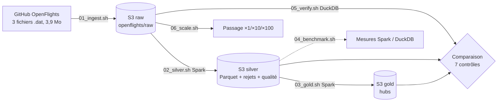

# Pipeline et choix

- **raw** : les 3 fichiers tels quels, plus un manifeste (date, taille, empreinte SHA-256).
- **silver** : schémas explicites (pas d'inférence), `\N` lu comme `NULL`, routes valides et routes rejetées séparées, rapport qualité.
- **gold.hubs** : une ligne par aéroport ayant au moins une route valide sortante (3 199 aéroports), avec `routes_out`, `routes_out_sans_codeshare`, `destinations_distinctes`, `destinations_distinctes_sans_codeshare`, `routes_in`, `airlines_out`, le classement après nettoyage (`rank_clean`), le classement brut par code IATA (`routes_out_raw`, `rank_raw`) et l'écart `rank_shift`.
- **Vérification** (run du 22/11/2026) : DuckDB recalcule les résultats depuis les CSV bruts, avec son propre code, et compare sept sorties : routes totales, routes valides, somme de `routes_out`, top 10 après nettoyage, top 5 brut, les quatre colonnes gold sur tous les aéroports, puis ATL sur routes/destinations/codeshare. Ces contrôles prouvent la cohérence Spark/DuckDB, pas l'exactitude métier.

## Effet du nettoyage sur le classement
Les cinq premiers sont inchangés (ATL 915, ORD 558, PEK 531, LHR 525, CDG 524). Écarts liés à la validation : PEK passe de 535
à 531 routes, LHR de 527 à 525, LAX de 492 à 489. L'aéroport `ISL` passe du rang 3 179 (comptage brut par code IATA) au rang
19 (comptage par identifiant) : 358 routes partant de son identifiant portent le code `IST` (voir `docs/qualite.md`), ce qui
explique une partie des 362 codes de départ incohérents du rapport qualité. Les chiffres viennent de `results/03_gold.log`.

## Ressources du run
Service `vscode-pyspark` du namespace `user-r-combe-tamain-ece`, pod `vscode-pyspark-198275-0` : CPU garanti 100m / limite 4000m
(`cpu.max` = `400000 100000`), mémoire garantie 400Mi / limite 3800Mi (`memory.max` = 3 984 588 800 octets), `nproc` = 16, driver
Spark 3 Go. Quota du namespace : limites 4 CPU / 4 Gi, demandes 1 CPU / 1 Gi, 8 pods, 20 Gi de stockage. Durée des six étapes
(UTC, 22/11/2026) : 11 s, 48 s, 35 s, 37 s, 9 s et 58 s, soit 3 min 18 s au total.

**Limite de vérification.** La vérification compare deux implémentations sur les mêmes règles. Elle prouve la cohérence entre moteurs, pas l’exactitude métier ; aucune source externe n’a été confrontée.
